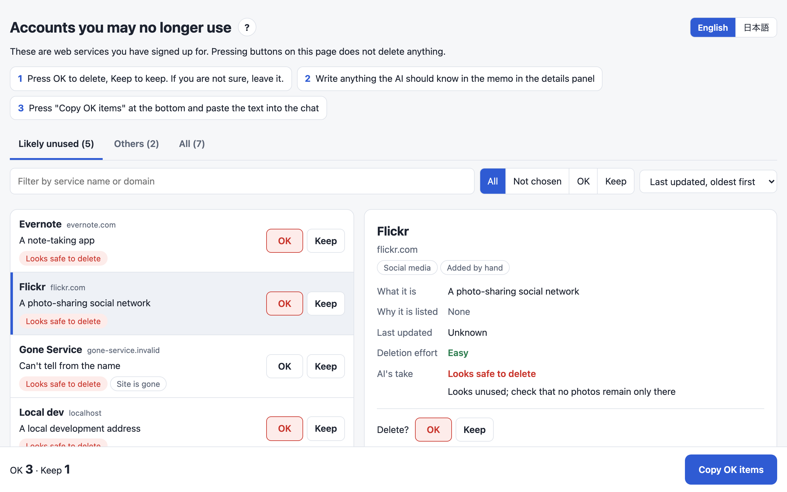

# Account Cleanup

使わなくなったWebアカウントを見つけ、要らない物を解約して削除します。
その間、エージェントがパスワードを目にすることは一度もありません。

[English](README.md) · 日本語



どのサービスに登録したか、どれにお金を払っているかを覚えておく必要はありません。
このプラグインは、1Password、Bitwarden、ブラウザに保存したパスワードから、サービス名、URL、日付だけを集めます。
各アカウントについて、使われていないと見た理由を示します。
あなたはページ上で、1つずつ「OK」か「ダメ」を付けます。
承認したアカウントについては、エージェントが認証情報を見ないまま1Passwordを使ってログインし、サブスクリプションの解約、登録済みの支払い方法の削除、アカウントの削除を行います。

```
集める                      エージェント
  ↓
理由と説明を付ける          エージェント
  ↓
OKかダメを付ける            あなた
  ↓
OKの分を解約して削除する    エージェント。二段階認証と、回ごとの承認はあなた
  ↓
パスワード管理を片付ける    エージェント。元に戻せる形で動かす
```

## インストール

```
/plugin marketplace add cardene777/agent-shuriken        # Claude Code
/plugin install account-cleanup@agent-shuriken

codex plugin marketplace add cardene777/agent-shuriken   # Codex
codex plugin add account-cleanup@agent-shuriken

copilot plugin marketplace add cardene777/agent-shuriken # GitHub Copilot CLI
copilot plugin install account-cleanup@agent-shuriken

gemini skills install https://github.com/cardene777/agent-shuriken.git --path plugins/account-cleanup/skills/account-cleanup   # Gemini CLI
```

`SKILL.md`を読むほかのエージェントでは、各リリースに添付したスキルのzipを、そのエージェントのスキル用フォルダに展開します。
手順は[はじめに](../../docs/getting-started.ja.md#マーケットプレイスを使わずにインストールする)にあります。

## 使い方

エージェントに「使っていないアカウントを整理したい」のように頼みます。
直接呼び出すこともできます。
Claude Codeでは`/account-cleanup:account-cleanup`を実行し、Codexでは`$`を入力して**Account Cleanup**を選びます。
GitHub Copilot CLIでは依頼の中に`/account-cleanup`と書き、Gemini CLIではやりたいことを伝えます。

1. どこから集めるかと、住んでいる地域を選びます。地域はEU、イギリス、カリフォルニア、日本、その他から選び、これでデータ消去の依頼に使うひな形が決まります
2. エージェントが使っていないと見られるアカウントに理由を付け、各サイトの短い説明を足して、候補を選ぶページを開きます
3. ページで、削除するアカウントには「OK」を、残すアカウントには「ダメ」を押します。最後に「OKの分をコピー」を押し、コピーされた文をチャットに貼ります
4. エージェントがApp Store、Google Play、PayPalのサブスクリプションの一覧を1回ずつ開き、そこで請求されているサブスクリプションを先に解約します
5. 削除を始める前に、その回で削除するアカウントの数を一度だけ承認します
6. エージェントは「OK」の各項目についてログインし、有料プランを解約し、登録済みのカードと銀行口座を外し、アカウントを削除します。二要素認証とCAPTCHAはあなたが対応します
7. アカウントを削除できないサービスについては、エージェントがGDPR、CCPA、日本の個人情報保護法にもとづくデータ消去の依頼文を下書きします
8. あなたが終わったと伝えると、エージェントは削除したアカウントの項目を、1Passwordならアーカイブへ、Bitwardenならゴミ箱へ移します

## 必要な物

| ツール | 必要な時 |
|---|---|
| `jq` | 常に |
| Node.js | エージェントがブラウザを操作する時。初めて使う時に、PlaywrightとChromiumをプラグインのデータフォルダへインストールします |
| `sqlite3` | ChromeなどのChromium系ブラウザから集める時 |
| `op`（1Password CLI） | 1Passwordから集める時。1Passwordアプリの設定で、CLIとの連携をオンにしてください |
| `bw`（Bitwarden CLI） | Bitwardenから集める時。エージェントを起動する前に、ターミナルで`export BW_SESSION="$(bw unlock --raw)"`を実行してください |

macOS向けに作っています。
スクリプトはLinuxでのChromium系ブラウザの保存場所も探しますが、Linuxでは試していません。

## 読む物と実行する物と送る物

すべての詳細は[仕組み](docs/how-it-works.ja.md)に載せています。
要点は次のとおりです。

- パスワード、ワンタイムコード、リカバリーキーを読むことも、表示することも、保存することも、送ることもありません
- あなたに関する情報をどのサービスにも送りません。削除ページを探すWeb検索に使うのは、サービス名とドメインだけです
- 各候補のドメインがまだ応答するかを、そのドメインだけに送る`HEAD`リクエストで確かめます
- 初めて使う時に、npmから`playwright-core`を、PlaywrightのダウンロードサーバーからChromiumを、データフォルダへインストールします
- ファイルは`~/.local/share/account-cleanup/`に置き、あなただけが読めるようにします。候補の一覧、候補を選ぶページ、ブラウザのプロファイルは、作業を終えた時に削除します

## 同梱しているデータ

削除ページの一覧`skills/account-cleanup/data/sites.json`は、公開されているJustDeleteMeのデータを、MITライセンスのもとで改変せずにコピーした物です。
出どころは[`THIRD_PARTY_NOTICES.md`](THIRD_PARTY_NOTICES.md)に記録しています。

## ライセンス

[MIT](LICENSE)
