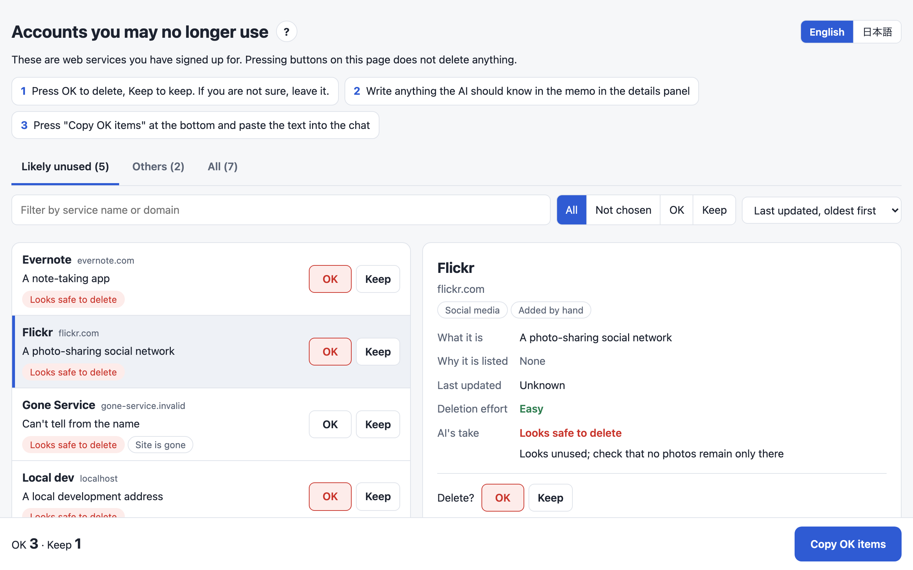

# Account Cleanup

Find the web accounts you no longer use, then cancel and delete the ones you don't need, without the agent ever seeing a password.

English · [日本語](README.ja.md)



You don't need to remember which services you signed up for or which ones you pay for.
The plugin collects only service names, URLs, and dates from 1Password, Bitwarden, and browser-saved passwords.
It explains why each account looks unused, and you mark each one OK or Keep on a page.
For the accounts you approve, the agent signs in from 1Password without seeing the credentials, cancels subscriptions, removes saved payment methods, and deletes the account.

```
Collect ──> Add reasons and descriptions ──> Mark OK or Keep ──> Cancel and delete OK items ──> Tidy the password manager
 (agent)     (agent)                          (you)               (agent; you do 2FA and         (agent, reversibly)
                                                                   approve each round)
```

## Install

```
/plugin marketplace add cardene777/agent-shuriken        # Claude Code
/plugin install account-cleanup@agent-shuriken

codex plugin marketplace add cardene777/agent-shuriken   # Codex
codex plugin add account-cleanup@agent-shuriken
```

## Use

Ask your agent something like "I want to clean up accounts I don't use anymore."
You can also call it directly: `/account-cleanup:account-cleanup` in Claude Code, or type `$` and pick **Account Cleanup** in Codex.

1. Choose which sources to collect from, and where you live (EU, UK, California, Japan, or elsewhere), which picks the erasure request template
2. The agent tags likely-unused accounts with reasons, adds a short description of each site, and opens the candidate sheet
3. On the sheet, press OK for each account to delete or Keep for those to keep, press "Copy OK items", and paste the text into the chat
4. The agent opens your App Store, Google Play, and PayPal subscription lists once and cancels any subscriptions billed there first
5. Before deletion starts, you approve the number of accounts in that round once
6. For each OK item, the agent signs in, cancels paid plans, removes saved cards and bank accounts, and deletes the account. You handle two-factor prompts and CAPTCHAs
7. For services that can't delete accounts, the agent drafts an erasure request under GDPR, CCPA, or Japan's APPI
8. When you say you're done, the agent moves the items for deleted accounts to the archive in 1Password or the trash in Bitwarden

## Requirements

| Tool | When it's needed |
|---|---|
| `jq` | Always |
| Node.js | When the agent drives the browser. On first use it installs Playwright and Chromium into the plugin's data folder |
| `sqlite3` | When collecting from Chrome and other Chromium browsers |
| `op` (1Password CLI) | When collecting from 1Password. Turn on CLI integration in the 1Password app settings |
| `bw` (Bitwarden CLI) | When collecting from Bitwarden. Run `export BW_SESSION="$(bw unlock --raw)"` in your terminal before starting the agent |

It is built for macOS.
The scripts also look in the Linux locations of Chromium browsers, but Linux is untested.

## What it reads, runs, and sends

[How it works](docs/how-it-works.md) lists everything in detail.
In short:

- It never reads, prints, stores, or sends a password, one-time code, or recovery key
- It sends nothing about you to any service. Web searches for deletion pages use only the service name and domain
- It checks whether each candidate's domain still answers, with a `HEAD` request to that domain only
- On first use it installs `playwright-core` from npm and Chromium from the Playwright download servers into its data folder
- Its files live in `~/.local/share/account-cleanup/`, readable only by you. The candidate list, the sheet, and the browser profile are deleted when you finish

## Bundled data

The deletion directory `skills/account-cleanup/data/sites.json` is an unmodified copy of the public JustDeleteMe data, under the MIT License.
Its source is recorded in [`THIRD_PARTY_NOTICES.md`](THIRD_PARTY_NOTICES.md).

## License

[MIT](LICENSE)
