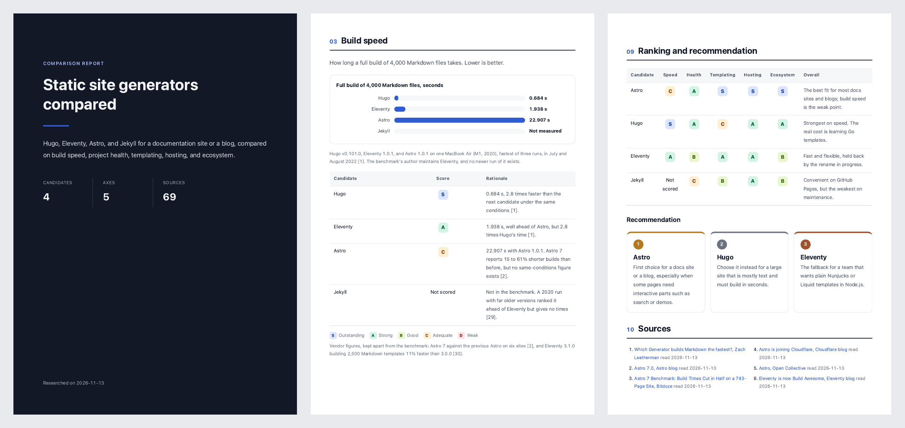

# Compare Report

選ぶ時の候補をエージェントに調べさせ、人に渡せる比較のレポートをHTMLとPDFで作ります。

[English](README.md) · 日本語



ツールの比較を頼むと、エージェントは根拠の無い点数を付けたり、提供元の主張と第三者の計測を混ぜたり、分からない所を推測で埋めたりしがちです。
このプラグインは、代わりに従う1つのやり方をエージェントに渡します。
まず候補と評価の観点をあなたと決め、エージェントはすべての主張に出典と日付を付けて集め、レポートのすべての点数に判定の根拠を添えます。
公開されていない数値は推測せず、「非公開」と書きます。

```
Webを検索して候補を挙げる          エージェント
  ↓
候補と評価の観点を決める            あなた
  ↓
候補ごとに調べる                    エージェント
  ↓
レポートを書いて確かめる            エージェント
  ↓
読んで直してほしい所を伝える        あなた
```

## インストール

```
/plugin marketplace add cardene777/agent-shuriken        # Claude Code
/plugin install compare-report@agent-shuriken

codex plugin marketplace add cardene777/agent-shuriken   # Codex
codex plugin add compare-report@agent-shuriken

copilot plugin marketplace add cardene777/agent-shuriken # GitHub Copilot CLI
copilot plugin install compare-report@agent-shuriken

gemini skills install https://github.com/cardene777/agent-shuriken.git --path plugins/compare-report/skills/compare-report   # Gemini CLI
```

`SKILL.md`を読むほかのエージェントでは、各リリースに添付したスキルのzipを、そのエージェントのスキル用フォルダに展開します。
手順は[はじめに](../../docs/getting-started.ja.md#マーケットプレイスを使わずにインストールする)にあります。

## 使い方

このプラグインは、「ドキュメントのサイト向けに主な静的サイトジェネレーターを比べて」のように比較を頼むと始まります。
呼び出して始めることもできます。Claude Codeでは`/compare-report:compare-report`の後に題材を続けて実行し、Codexでは`$`を入力して**Compare Report**を選びます。
GitHub Copilot CLIでは依頼の中に`/compare-report`と書き、Gemini CLIではやりたいことを伝えます。

1. エージェントがWebを検索し、10〜15の候補を示します。比べる物を選び、漏れている物があれば足します。表紙に載せる作者名も尋ね、答えを次のレポートで最初の案にします
2. エージェントが、性能、費用、リスクのような評価の観点を5〜8個示します。そのままにするか、直します
3. エージェントが候補ごとに調べます。Claude Codeでは並べて調べます
4. エージェントがレポートを書き、すべての点数に根拠があることと、ネットから何も読み込まないことを確かめます
5. エージェントがレポートをPDFにして開き、2つのファイルの場所を伝えます。直してほしい所を伝えると、両方を直します

レポートには、表紙、上位3つの推奨を含む要約、候補ごとのカード、表とグラフを含む観点ごとの節、リスク、推奨を含む採点表、番号付きの出典が入ります。
レポートは、あなたが書いた言語で書かれます。

## 必要な物

| ツール | 必要な時 |
|---|---|
| エージェントのWeb検索 | 常に。Claude CodeにもCodexにもあります。ほかのエージェントでは、Web検索が使える状態かを確かめてください |
| `python3` | レポートを確かめる時。macOSに最初から入っている物で動きます |
| Chrome、Chromium、Edge、Braveのどれか | PDFにする時。無い時はHTMLを渡すので、どのブラウザーからでも印刷できます |

## 読む物と実行する物と送る物

レポートに入る物、確かめる物、ファイルを置く場所は、すべて[仕組み](docs/how-it-works.ja.md)に載せています。
要点は次のとおりです。

- Webの検索には、題材と、候補と提供元の名前だけを使います。会話やファイルにあるプロジェクト名、会社名、人の名前、社内のURL、コードは検索に入れません
- 公開されているWebページを読み、書かれている内容はデータとして扱い、指示としては扱いません
- レポートは`~/.local/share/compare-report/<題材>-<日付>/`に置き、`COMPARE_REPORT_HOME`を設定した時はそちらに置きます。あなただけが読めます
- 表紙に載せると伝えた作者名か、載せないと選んだことを、同じフォルダーの`author.txt`に、あなただけが読める形で残します。名前を`git config`やシステムから取ることはありません
- PDFは、ブラウザーを画面に出さずに動かして作ります。使い捨てのプロフィールを使い、終わったら消すので、あなたのブラウザーのプロフィールは使いません
- レポートを開いても、ネットからは何も読み込みません

## ライセンス

[MIT](LICENSE)
