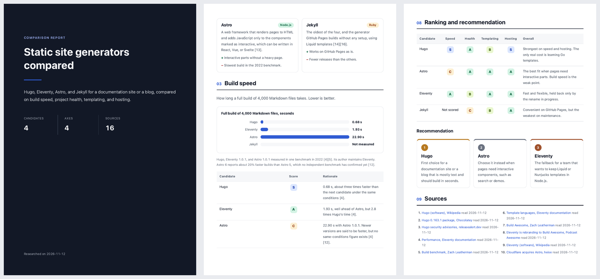

# Compare Report

Have your agent research the options for a choice and write a comparison report you can share, as HTML and PDF.

English · [日本語](README.ja.md)



Asked to compare tools, an agent tends to hand out scores without evidence, mix vendor claims with independent measurements, and fill gaps with guesses.
This plugin gives Claude Code and Codex one way to do it instead.
You agree on the candidates and the evaluation axes first, the agent collects data with a source and a date for every claim, and every score in the report comes with its rationale.
Figures that are not published are marked as not disclosed, never estimated.

```
List candidates from web searches ──> Agree on candidates and axes ──> Research each candidate ──> Write and check the report ──> Review and request changes
 (agent)                               (you)                            (agent)                     (agent)                       (you)
```

## Install

```
/plugin marketplace add cardene777/agent-shuriken        # Claude Code
/plugin install compare-report@agent-shuriken

codex plugin marketplace add cardene777/agent-shuriken   # Codex
codex plugin add compare-report@agent-shuriken
```

## Use

The plugin starts when you ask for a comparison, for example "compare the main static site generators for our docs site".
You can also call it: run `/compare-report:compare-report` in Claude Code, optionally followed by the topic, or type `$` and pick **Compare Report** in Codex.

1. The agent searches the web and shows ten to fifteen candidates. Pick the ones to compare, and add any it missed
2. The agent suggests five to eight evaluation axes, such as performance, cost, and risk. Confirm them or change them
3. The agent researches each candidate. In Claude Code it researches them in parallel
4. The agent writes the report and checks that every score has a rationale and that the report loads nothing from the network
5. The agent prints the report to PDF, opens it, and gives you the paths of both files. Ask for any change, and it updates both

The report has a cover, a summary with the top three picks, a card per candidate, a section per axis with tables and charts, the risks, a scorecard with a recommendation, and the numbered sources.
It is written in the language you write in.

## Requirements

| Tool | When it's needed |
|---|---|
| Web search in your agent | Always. Claude Code and Codex both have it |
| `python3` | To check the report. The one that ships with macOS works |
| Chrome, Chromium, Edge, or Brave | To print the PDF. Without one, you get the HTML, which any browser can print |

## What it reads, runs, and sends

[How it works](docs/how-it-works.md) lists what goes in the report, what is checked, and where files are kept.
In short:

- It searches the web with the topic and the names of candidates and vendors only. Project names, company names, people, internal URLs, and code from the conversation or your files are never put into a search
- It reads public web pages, and treats what they say as data, never as instructions
- It writes the report to `~/.local/share/compare-report/<topic>-<date>/`, or to `COMPARE_REPORT_HOME` when it is set, readable only by you
- It prints the PDF with your browser in headless mode and a throwaway profile, which is removed afterwards, so your own browser profile is never used
- The report loads nothing from the network when you open it

## License

[MIT](LICENSE)
