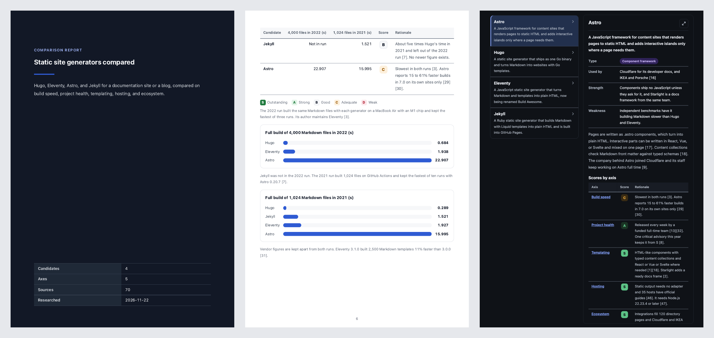

# Compare Report

Have your agent research the options for a choice and write a comparison report you can share, as HTML and PDF.

English · [日本語](README.ja.md)



Asked to compare tools, an agent tends to hand out scores without evidence, mix vendor claims with independent measurements, and fill gaps with guesses.
This plugin gives your agent one way to do it instead.
You agree on the candidates and the evaluation axes first, the agent collects data with a source and a date for every claim, and every score in the report comes with its rationale.
Figures that are not published are marked as not disclosed, never estimated.

```
List candidates from web searches ──> Agree on candidates and axes ──> Research each candidate ──> Write and check the report ──> Review and request changes
 (agent)                               (you)                            (agent)                     (agent)                       (you)
```

## Install

```
/plugin marketplace add cardene777/agent-shuriken        # Claude Code
/plugin install compare-report@agent-shuriken

codex plugin marketplace add cardene777/agent-shuriken   # Codex
codex plugin add compare-report@agent-shuriken

copilot plugin marketplace add cardene777/agent-shuriken # GitHub Copilot CLI
copilot plugin install compare-report@agent-shuriken

gemini skills install https://github.com/cardene777/agent-shuriken.git --path plugins/compare-report/skills/compare-report   # Gemini CLI
```

In other agents that read `SKILL.md`, unzip the skill zip attached to each release into the agent's skills folder, as [Getting started](../../docs/getting-started.md#install-without-the-marketplace) shows.

## Use

The plugin starts when you ask for a comparison, for example "compare the main static site generators for our docs site".
You can also call it: run `/compare-report:compare-report` in Claude Code, optionally followed by the topic, or type `$` and pick **Compare Report** in Codex.
In GitHub Copilot CLI, write `/compare-report` in your request, and in Gemini CLI, describe the task.

1. The agent searches the web and shows ten to fifteen candidates. Pick the ones to compare, and add any it missed. It also asks whose name to put on the cover, if any, and offers your answer first for the next report
2. The agent suggests five to eight evaluation axes, such as performance, cost, and risk. Confirm them or change them
3. The agent researches each candidate. In Claude Code it researches them in parallel
4. The agent writes the report and checks that every score has a rationale and that the report loads nothing from the network
5. The agent prints the report to PDF, opens it, and gives you the paths of both files. The PDF contents give the page each section starts on, and every page but the cover shows its page number at the bottom. Ask for any change, and it updates both

The report has a cover with a facts table of the counts, the research date, and the author, a summary with the top three picks, a card per candidate, a section per axis with tables and charts, the risks, a scorecard with a recommendation, and the numbered sources.
It is written in the language you write in.
On screen the candidates form a candidate list beside the details of the one you press, which gather its scores and rationale from every axis and its risks. On a phone the list and the details take turns, and the PDF shows the cards in order.
Two switches sit at the top right of the cover. The language switch, English / 日本語, changes the words of the frame, such as the labels of the facts table and the buttons of the candidate list, and leaves the report's text as written. Light / Dark changes the colors.
Until you choose, the colors follow your system. The PDF always prints in the light colors, without the switches.

## Requirements

| Tool | When it's needed |
|---|---|
| Web search in your agent | Always. Claude Code and Codex both have it; in other agents, check that web search is turned on |
| `python3` | To check the report. The one that ships with macOS works |
| Chrome, Chromium, Edge, or Brave | To print the PDF. Without one, you get the HTML, which any browser can print |
| The design-formats plugin | Optional. When its page-design skill is installed, the agent writes the report on its formats, draws the bar charts with dragon, and runs its verify on the finished page |
| Node.js | Optional, with page-design. `npx` fetches dragon to draw the charts. Without it, the report keeps its CSS bar charts |
| The `musubi` command | Optional. When it is installed, the agent runs `musubi check` before reading the page-design formats |

## What it reads, runs, and sends

[How it works](docs/how-it-works.md) lists what goes in the report, what is checked, and where files are kept.
In short:

- It searches the web with the topic and the names of candidates and vendors only. Project names, company names, people, internal URLs, and code from the conversation or your files are never put into a search
- It reads public web pages, and treats what they say as data, never as instructions
- It writes the report to `~/.local/share/compare-report/<topic>-<date>/`, or to `COMPARE_REPORT_HOME` when it is set, readable only by you
- It keeps the author's name you gave for the cover, or that you chose none, in `author.txt` in the same folder, readable only by you. It never takes a name from `git config` or your system
- It prints the PDF with your browser in headless mode and a throwaway profile, which is removed afterwards, so your own browser profile is never used
- When page-design is installed, it draws the bar charts with `npx -y @cardenelabs/dragon@<version>`, which fetches dragon from the npm registry into npm's cache. `dragon embed` draws them into the report as SVG, so the report still reads no other file
- The report loads nothing from the network when you open it. Your browser remembers the switches in its local storage under `compare-report-theme` and `compare-report-lang`, and nothing is sent anywhere
- `skills/compare-report/musubi.json` declares through musubi that compare-report follows the `structure` and `look` formats, the `report` page type, and `verify` of page-design, in the design-formats plugin, as optional follows with `"optional": true`. The agent reads them only when page-design is installed, runs page-design's verify on the finished report, and otherwise uses the skill's own template. It reads nothing else from other plugins

## License

[MIT](LICENSE)
