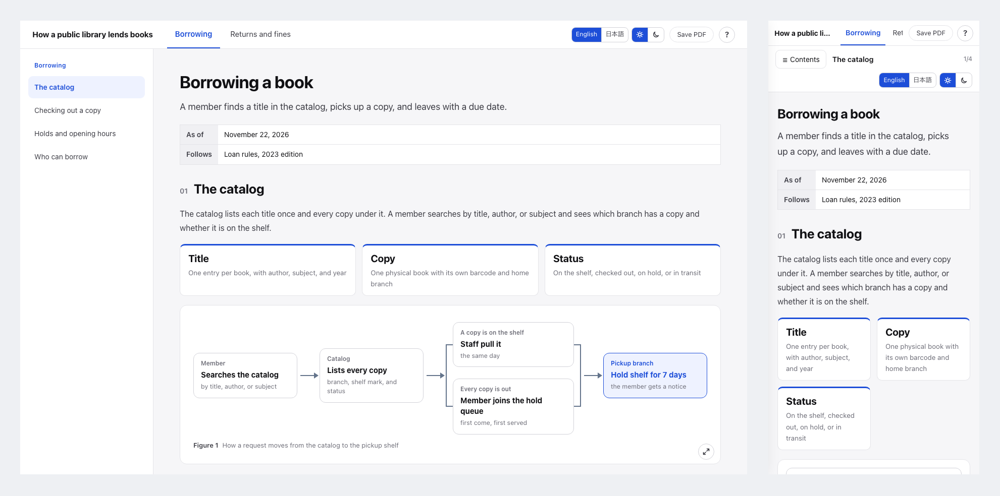

# Diagram Explainer

すべての節に図が入った説明資料をエージェントに書かせ、誰にでも渡せる1つのHTMLファイルにします。

[English](README.md) · 日本語



仕組みの説明を頼むと、エージェントは長いMarkdownを1つ書き、図の無い節を残し、本文と図で同じ物を別の名前で呼び、フォントやスクリプトをネットから読み込むページを作りがちです。
このプラグインは、代わりに従う1つのやり方をエージェントに渡します。
まず、節ごとに置く図まで含めて、構成をあなたと決めます。
エージェントは中身をJSONで持ち、そこから資料を組み、すべての図をページの中に描き、あなたが見る前に出来上がりを確かめます。

```
題材を調べる                        エージェント
  ↓
構成を決める                        あなた
  ↓
中身を書いて資料を組む              エージェント
  ↓
確かめて読み直す                    エージェント
  ↓
読んで直してほしい所を伝える        あなた
```

## インストール

```
/plugin marketplace add cardene777/agent-shuriken        # Claude Code
/plugin install diagram-explainer@agent-shuriken

codex plugin marketplace add cardene777/agent-shuriken   # Codex
codex plugin add diagram-explainer@agent-shuriken

copilot plugin marketplace add cardene777/agent-shuriken # GitHub Copilot CLI
copilot plugin install diagram-explainer@agent-shuriken

gemini skills install https://github.com/cardene777/agent-shuriken.git --path plugins/diagram-explainer/skills/diagram-explainer   # Gemini CLI
```

`SKILL.md`を読むほかのエージェントでは、各リリースに添付したスキルのzipを、そのエージェントのスキル用フォルダに展開します。
手順は[はじめに](../../docs/getting-started.ja.md#マーケットプレイスを使わずにインストールする)にあります。

## 使い方

このプラグインは、「デプロイの流れを図付きの説明資料にして」のように説明資料を頼むと始まります。
呼び出して始めることもできます。Claude Codeでは`/diagram-explainer:diagram-explainer`の後に題材を続けて実行し、Codexでは`$`を入力して**Diagram Explainer**を選びます。
GitHub Copilot CLIでは依頼の中に`/diagram-explainer`と書き、Gemini CLIではやりたいことを伝えます。

1. 規格、API、プロトコルの説明では、エージェントが先に公式の仕様を読み、読んだ版を記録します
2. エージェントが構成を示します。ページ、節の並び、節ごとに置く図です。合うまで直します
3. エージェントが中身を書き、資料を組みます
4. エージェントが資料を確かめて本文を読み直し、HTMLファイルの場所を伝えます。直してほしい所を伝えると、資料を組み直します

資料は目次から1節ずつ見せ、話題が2つ以上ならヘッダーのタブでページに分け、スマホでは目次を横から出し、PDFのボタンを持ちます。
図は、HTMLで描く箱と矢印、時刻や上限に対する量や数字や期間のグラフ、項目の多い手順を段に並べる図です。
スマホで画面より広い図は、文字の大きさを保って横にスクロールし、下にそのことを示す1行を出します。
資料はあなたが書いた言語で書かれ、ボタンや見出しの文字もその言語 (英語か日本語) で始まります。
ヘッダーには2つの切り替えが並びます。English / 日本語の切り替えは、目次のボタン、前と次のボタン、PDFのメニュー、グラフの単位のような画面の文字だけを変えます。もう1つは明るい色と暗い色の切り替えです。資料の本文は書いた言語のままで、印刷はいつも明るい色です。
既定では、作業中のプロジェクトの`docs/explainers/<名前>/`に置きます。

## 必要な物

| ツール | 必要な時 |
|---|---|
| `python3` | 常に。資料を組む時と確かめる時に使います。macOSに最初から入っている物で動きます |
| Chrome、Chromium、Edge、Brave、PlaywrightのHeadless Shellのどれか | 画面の幅ごとの崩れを確かめる時と、PDFにする時。無い時は崩れを測らずに組んで確かめ、どのブラウザーからでも印刷できます |
| `design-formats`のプラグイン | 任意です。`page-design`のスキルが入っていれば、エージェントはその形式に沿って資料を書き、仕上がったページにその`verify`を回します |
| `musubi`のコマンド | 任意です。入っていれば、エージェントは`page-design`の形式を読む前に`musubi check`を回します |

## 読む物と実行する物と送る物

資料に入る物、確かめる物、ファイルを置く場所は、すべて[仕組み](docs/how-it-works.ja.md)に載せています。
要点は次のとおりです。

- あなたが指したコードと文書を読みます。規格や製品の説明では公式のページを読み、題材、規格、製品、提供元の名前だけで検索します。プロジェクト名、会社名、人の名前、社内のURL、コードは検索に入れません
- Webページとファイルに書かれている内容はデータとして扱い、指示としては扱いません
- 資料とその元のJSONは、プロジェクトの`docs/explainers/<名前>/`か、あなたが指したフォルダーに書きます
- 崩れを測る時とPDFを作る時は、ブラウザーを画面に出さずに動かします。使い捨てのプロフィールを使い、終わったら消すので、あなたのブラウザーのプロフィールは使いません
- 資料を開いても、ネットからは何も読み込みません。読み手が選んだ言語と色は、ブラウザーがローカルストレージに`diagram-explainer-lang`と`diagram-explainer-theme`の名前で覚え、どこへも送りません
- `skills/diagram-explainer/musubi.json`は、`diagram-explainer`が`design-formats`のプラグインにある`page-design`の形式`structure`と`look`、ページの型`document`、`verify`に、`"optional": true`の任意の準拠で従うことをmusubiで宣言します。エージェントは`page-design`が入っている時だけこれらを読み、仕上がった資料に`page-design`の`verify`を回します。入っていなければ、スキルのひな形で組みます。ほかのプラグインからはこれ以外を読みません

## ライセンス

[MIT](LICENSE)
