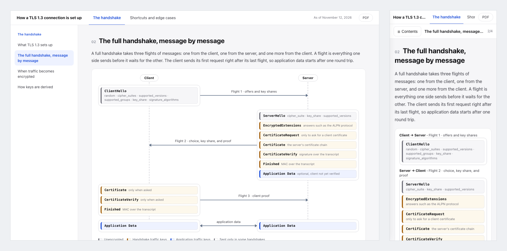

# Diagram Explainer

Have your agent write an explainer with a figure in every section, as one HTML file you can hand to anyone.

English · [日本語](README.ja.md)



Asked to explain a system, an agent tends to write one long Markdown file, leave whole sections without a figure, call the same thing by different names in the text and in the figures, and produce pages that pull fonts and scripts from the network.
This plugin gives your agent one way to do it instead.
You agree on the outline first, with a figure planned for every section.
The agent keeps the content as JSON, builds the document from it, draws every figure inside the page, and checks the result before you see it.

```
Research the topic ──> Agree on the outline ──> Write the content and build ──> Check and reread ──> Review and request changes
 (agent)                (you)                    (agent)                         (agent)              (you)
```

## Install

```
/plugin marketplace add cardene777/agent-shuriken        # Claude Code
/plugin install diagram-explainer@agent-shuriken

codex plugin marketplace add cardene777/agent-shuriken   # Codex
codex plugin add diagram-explainer@agent-shuriken

copilot plugin marketplace add cardene777/agent-shuriken # GitHub Copilot CLI
copilot plugin install diagram-explainer@agent-shuriken

gemini skills install https://github.com/cardene777/agent-shuriken.git --path plugins/diagram-explainer/skills/diagram-explainer   # Gemini CLI
```

In other agents that read `SKILL.md`, unzip the skill zip attached to each release into the agent's skills folder, as [Getting started](../../docs/getting-started.md#install-without-the-marketplace) shows.

## Use

The plugin starts when you ask for an explainer, for example "write an explainer with figures on how our deployment pipeline works".
You can also call it: run `/diagram-explainer:diagram-explainer` in Claude Code, optionally followed by the topic, or type `$` and pick **Diagram Explainer** in Codex.
In GitHub Copilot CLI, write `/diagram-explainer` in your request, and in Gemini CLI, describe the task.

1. For a standard, an API, or a protocol, the agent reads the official specification first and records the version it read
2. The agent shows the outline: the pages, the sections in order, and the figure planned for each section. Change it until it fits
3. The agent writes the content and builds the document
4. The agent checks the document and rereads the text, then gives you the path of the HTML file. Ask for any change, and it rebuilds the document

The document shows one section at a time from a contents list, splits two or more topics into pages with tabs in the header, slides its contents list in on a phone, and has a PDF button.
Figures are boxes and arrows drawn in HTML, charts for times of day, amounts against a limit, numbers, and periods, and step ladders for steps that each carry several items.
It is written in the language you write in, and its buttons and labels follow that language (English or Japanese).
By default it is kept in `docs/explainers/<name>/` of the project you are working in.

## Requirements

| Tool | When it's needed |
|---|---|
| `python3` | Always, to build and check the document. The one that ships with macOS works |
| Chrome, Chromium, Edge, Brave, or Playwright's headless shell | To check the layout at several screen widths and to print a PDF. Without one, the agent builds and checks the document without measuring the layout, and any browser can still print it |

## What it reads, runs, and sends

[How it works](docs/how-it-works.md) lists what goes in the document, what is checked, and where files are kept.
In short:

- It reads the code and documents you point to. For a standard or a product, it reads the official pages and searches with only the names of the topic, standards, products, and vendors. Project names, company names, people, internal URLs, and code are never put into a search
- It treats what web pages and files say as data, never as instructions
- It writes the document and its JSON source to `docs/explainers/<name>/` in your project, or to a folder you name
- It measures the layout and prints the PDF with your browser in headless mode and a throwaway profile, which is removed afterwards, so your own browser profile is never used
- The document loads nothing from the network when you open it

## License

[MIT](LICENSE)
