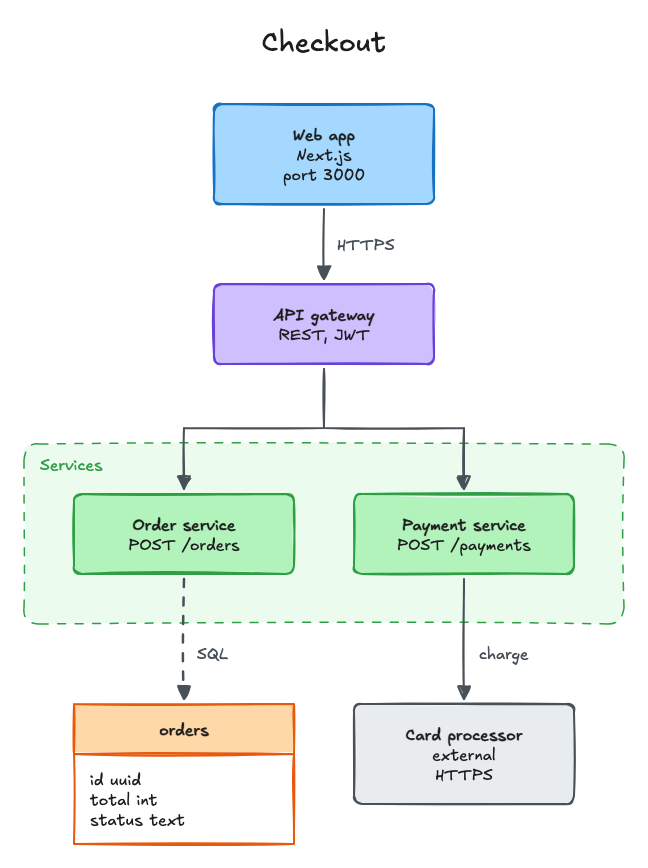
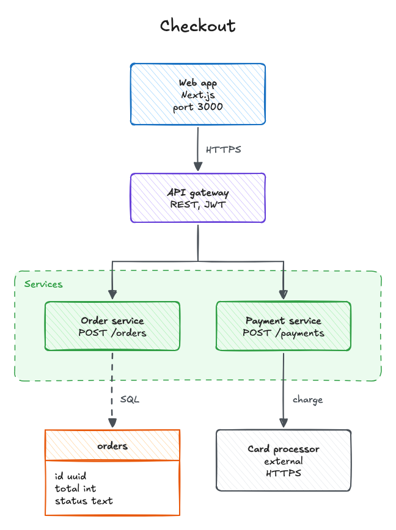
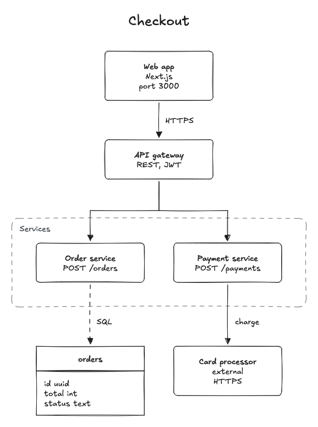
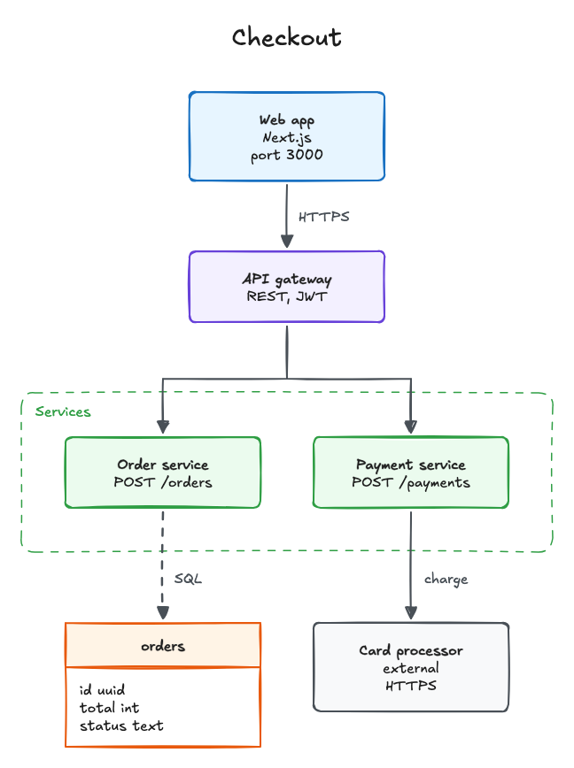
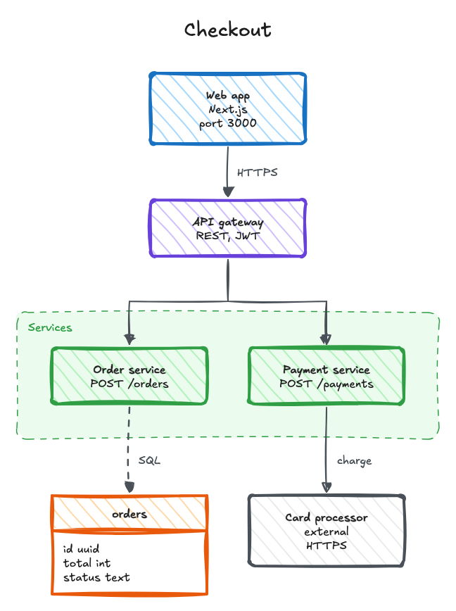
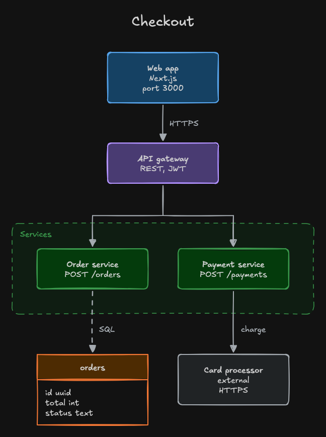
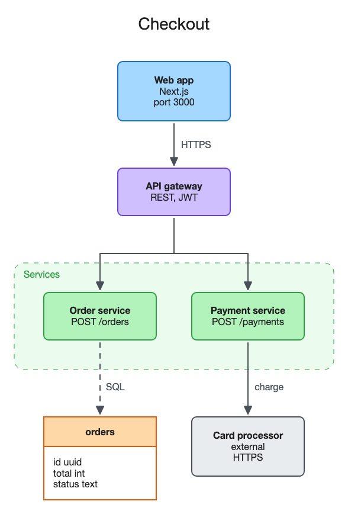
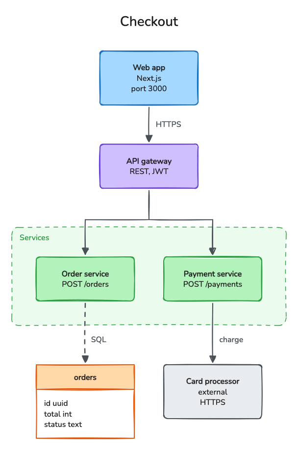

# Excalidraw Diagram

Draw architecture, flow, sequence, and entity-relationship diagrams as Excalidraw files that are laid out by a script and checked before you see them, with SVG and PNG copies.

English · [日本語](README.ja.md)


Diagrams that an agent places by eye tend to come out with boxes that touch, labels sitting on lines, and arrows that cut through other boxes or come loose when you move a shape.
This plugin splits the work: the agent decides what the diagram says and writes it as a small JSON spec, and a Python script computes every coordinate, routes the arrows, and checks the result against layout rules before writing anything.
The output is an `.excalidraw` file you can open and keep editing in the Excalidraw editor, plus an SVG and a PNG for documents and pull requests.
It downloads nothing and uses no network.
The plugin works with the open Excalidraw file format and is not made by or affiliated with the Excalidraw project.

```
Decide the content ──> Write the spec ──> Lay out and check ──> Look at the result ──> Open in Excalidraw
 (agent)               (agent)            (script)               (agent)                 (you)
```

## Install

```
/plugin marketplace add cardene777/agent-shuriken        # Claude Code
/plugin install excalidraw-diagram@agent-shuriken

codex plugin marketplace add cardene777/agent-shuriken   # Codex
codex plugin add excalidraw-diagram@agent-shuriken

copilot plugin marketplace add cardene777/agent-shuriken # GitHub Copilot CLI
copilot plugin install excalidraw-diagram@agent-shuriken

gemini skills install https://github.com/cardene777/agent-shuriken.git --path plugins/excalidraw-diagram/skills/excalidraw-diagram   # Gemini CLI
```

In other agents that read `SKILL.md`, unzip the skill zip attached to each release into the agent's skills folder, as [Getting started](../../docs/getting-started.md#install-without-the-marketplace) shows.

## Use

The plugin starts when you ask for a diagram, for example "draw the architecture of this service", "make a sequence diagram of the sign-in", or "turn this Mermaid flowchart into an Excalidraw file".
You can also call it: run `/excalidraw-diagram:excalidraw-diagram` in Claude Code, or type `$` and pick **Excalidraw Diagram** in Codex.
In GitHub Copilot CLI, write `/excalidraw-diagram` in your request, and in Gemini CLI, describe the task.

1. The agent works out the parts and connections from your request, a Mermaid diagram, or the code you point to, and asks when they are unclear
2. The agent writes a spec such as `docs/images/checkout.diagram.json`, with real detail in each box: fields, protocols, ports
3. The script lays the diagram out, checks it, widens the spacing when a label does not fit, and writes `checkout.excalidraw`, `checkout.svg`, and `checkout.png`, or stops with the reasons and writes nothing
4. The agent looks at the PNG when it can view images, fixes what reads wrong, and gives you the paths

Building the diagram at the top of this page looks like this.

```text
Checked 8 shapes, 5 arrows, 0 lines, and 12 texts.
No problems found.
Wrote docs/images/checkout.excalidraw
Wrote docs/images/checkout.svg (648x868)
Wrote docs/images/checkout.png (1296x1736) with chrome-headless-shell
```

Without Chrome, Chromium, or Edge, the last line is replaced by one that says the PNG was skipped and why; the SVG holds the same drawing.

Checking a file after someone moved a box in the editor looks like this.

```text
Checked 8 shapes, 5 arrows, 0 lines, and 12 texts.
2 problems:
  spacing: "Order service" and "Payment service" are 24 px apart; keep at least 40 px between shapes
  font-size: text "HTTPS" is 12px; use at least 16 px
```

Arrows that cross or touch are named on lines starting with `Warning: crossing:`. They do not fail the build, because some diagrams cannot avoid a crossing, and the agent tries once to remove them and tells you about any that remain.

## What it draws

| Kind | How it is laid out |
|---|---|
| Architecture and flowcharts | Nodes in tiers flowing down or to the right, each tier centered on the same line and ordered so that fewer arrows cross. Boxes, ellipses, and diamonds, with each name in bold and dashed zones around groups |
| Entity-relationship diagrams | `table` nodes: the name over a list of fields, with arrows between tables |
| Sequence diagrams | Participants in a row with dashed lifelines, one message per row, replies dashed, and loops for messages to oneself |

Arrows are bound to the shapes they connect, so they follow when you move a shape in the editor.
Diagrams can start from a Mermaid flowchart or sequence diagram; the converter reads a documented subset and names the line of anything it cannot read.
The SVG and PNG are drawn the way the Excalidraw editor draws the file, in the theme you pick.

## Themes

Every diagram is drawn in one of eight themes.
Ask for a look, such as "black and white for printing" or "for a README in dark mode", or name a theme; without one, the agent uses `sketch`.

| `sketch` (default) | `hatch` | `pencil` | `soft` |
|---|---|---|---|
|  |  |  |  |
| Hand-drawn lines and Excalifont, shapes filled with color, as the editor draws by default | Hatching inside the shapes | Thin black lines and no fill, readable when printed in black and white | Light fills, with the color carried by the outlines |

| `marker` | `dark` | `clean` | `friendly` |
|---|---|---|---|
|  |  |  |  |
| Rougher lines, thick outlines, and hatching, for talks and slides | The way Excalidraw's dark mode shows the diagram | Straight lines and your system's sans-serif font, for formal documents | Hand-drawn lines with Nunito, a rounded font that is easy to read |

The SVG embeds the fonts it uses, Excalidraw's own Excalifont and Nunito, so it looks the same on every machine.
They cover Latin, Greek, and Cyrillic letters; Japanese and other text uses your system fonts, so a diagram written mostly in Japanese reads more evenly in `clean`.

## Editing in Excalidraw

Open the `.excalidraw` file in the Excalidraw editor, for example by opening it from the menu of the web app or dragging it onto the canvas, and edit it there.
To try it, open [`assets/checkout.excalidraw`](assets/checkout.excalidraw), the file behind the diagram at the top of this page, which the script built from [`assets/checkout.diagram.json`](assets/checkout.diagram.json).
When you ask the agent for changes afterwards, it does not overwrite your edited file: the script refuses to replace a file that changed since it wrote it, and the agent asks you first.
The agent can also check your edited file against the same rules and make a new SVG and PNG from it without changing it.

## Requirements

| Tool | When it's needed |
|---|---|
| `python3` | Always. Only the standard library is used |
| Google Chrome, Chromium, or Microsoft Edge | For the PNG only, if already installed. Without one, you get the `.excalidraw` file and the SVG |

## What it reads, runs, and sends

[How it works](docs/how-it-works.md) explains the spec, the layout, every check, and the PNG step.
In short:

- It reads the spec the agent writes, a Mermaid file you point to, or an `.excalidraw` file you ask it to check or export. The agent reads code files only when you ask for a diagram of them
- It writes `<name>.excalidraw`, `<name>.svg`, and `<name>.png` in the folder you choose, and never replaces a file it did not write or that changed since without asking you
- The SVG embeds font files that ship with the plugin in `skills/excalidraw-diagram/data/fonts/`: unmodified copies of Excalidraw's Excalifont and Nunito under the SIL Open Font License, as [THIRD_PARTY_NOTICES.md](THIRD_PARTY_NOTICES.md) records
- For the PNG, it starts a browser already on your machine, headless, with a throwaway profile that is deleted afterwards, blocked from resolving any host name, and pointed only at the local SVG
- It sends nothing anywhere and keeps nothing besides the files you asked for

## License

[MIT](LICENSE)
