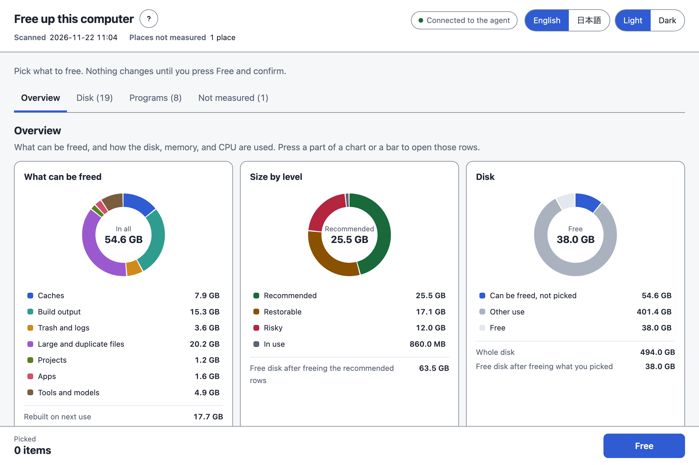
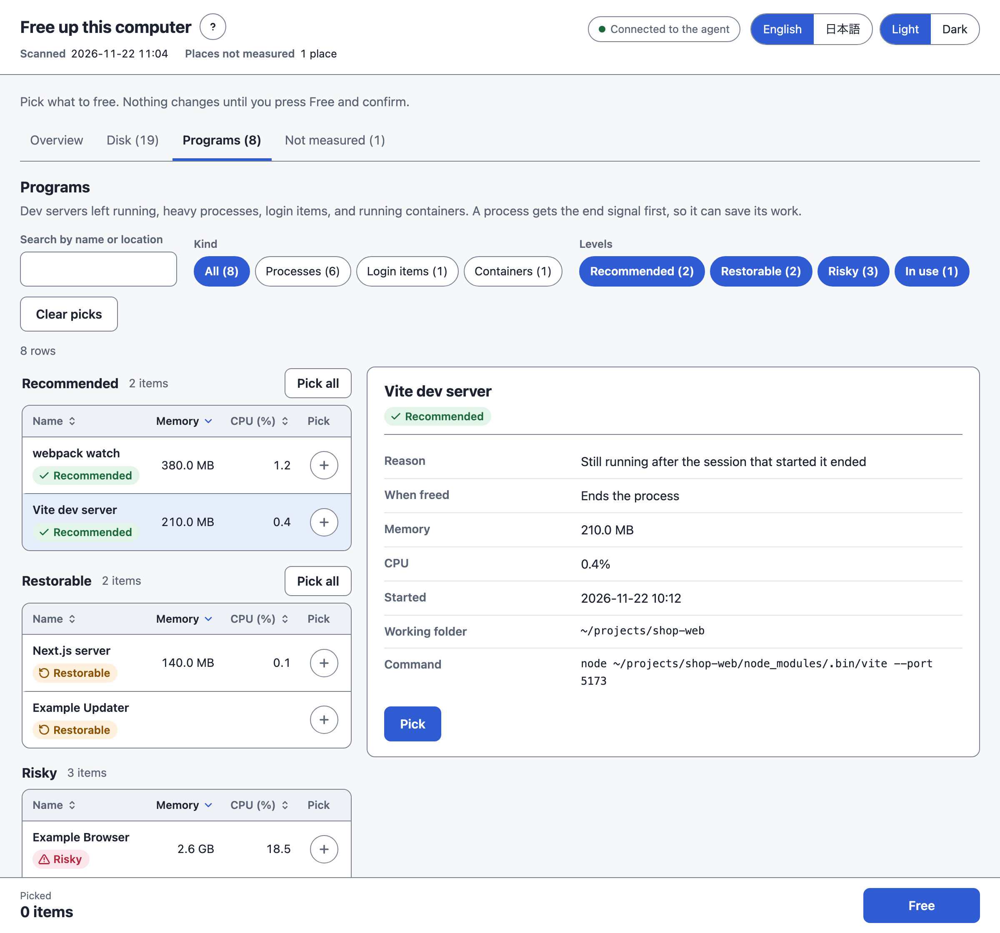

# Machine Cleanup

コンピューターのディスクの空きとメモリとCPUを、選んだ物だけを空けて取り戻します。

[English](README.md) · 日本語



コーディングのエージェントは多くの物を残します。
プロジェクトごとの`node_modules`とビルドの出力、パッケージ管理とDockerのキャッシュ、XcodeのDerivedData、1か月開いていないプロジェクト、Node.jsとPythonとRubyとRustの古い版、落としたAIモデル、始めた会話が終わった後も動き続ける開発用のサーバーと監視です。
このプラグインはそれらを最も低い優先度で測り、項目ごとの大きさか負荷と空けた時に起きることをブラウザのページに並べ、そこで選んだ物だけを空けます。
動いているエージェントの会話、開いている端末、同じプロジェクトで動いているプログラムが使う物は、表示しますが選べないので、片付けが別の会話の作業を壊しません。

```
Scan ──> Pick on the page ──> Check each pick again ──> Free it ──> Report before and after
 (agent)  (you)                (agent)                   (agent)     (agent)
```

## インストール

```
/plugin marketplace add cardene777/agent-shuriken        # Claude Code
/plugin install machine-cleanup@agent-shuriken

codex plugin marketplace add cardene777/agent-shuriken   # Codex
codex plugin add machine-cleanup@agent-shuriken

copilot plugin marketplace add cardene777/agent-shuriken # GitHub Copilot CLI
copilot plugin install machine-cleanup@agent-shuriken

gemini skills install https://github.com/cardene777/agent-shuriken.git --path plugins/machine-cleanup/skills/machine-cleanup   # Gemini CLI
```

`SKILL.md`を読むほかのエージェントでは、各リリースに付く技のzipをエージェントの技のフォルダに展開します。手順は[はじめに](../../docs/getting-started.ja.md#install-without-the-marketplace)にあります。

## 使い方

「ディスクがいっぱい」「Macが重い」「メモリを何が使っているか知りたい」のように言うと、プラグインが始まります。
呼び出すこともできます。Claude Codeでは`/machine-cleanup:machine-cleanup`を打ち、Codexでは`$`を打って**Machine Cleanup**を選びます。
GitHub Copilot CLIでは依頼の文に`/machine-cleanup`と書き、Gemini CLIでは作業を説明します。

1. エージェントが調べ (最も低い優先度で最大90秒)、合計を伝えます
2. ブラウザでページが**全体**のタブで開き、空けられる分と、ディスクとメモリとCPUの使われ方を図で見せます。**ディスク**と**プログラム**のタブは、行を推奨度ごとの表に並べます。推奨度は**おすすめ**、**戻せる**、**影響あり**、**使用中**の4つで、各行に印として出ます。行の名前を押すと、理由と場所とコマンドが一覧の横に出ます。幅の狭い画面では一覧と入れ替わって出て、**一覧へ戻る**と前後の行へのリンクが付き、アドレスは出している行を`#item-<id>`で覚えます
3. 名前か場所で探し、種類と推奨度で絞り込み、列の見出しで並べ替え、50行ずつページを送ります。空けたい行を行の端のボタンで選ぶか、おすすめか戻せるの見出しで**全部選ぶ**を押します。**空ける**を押し、選んだ行を空けた時に起きることごとに並べた画面を確かめて、そこで**空ける**を押します
4. エージェントは選んだ物を1件ずつ確かめ直し、変わった物と使われ始めた物を飛ばして残りを空け、ディスクの空きとメモリと負荷の前後を伝えます
5. 終了の合図を聞かないプロセスがあると、エージェントはすぐに終わらせる前にあなたに聞きます



ページは英語で開き、ヘッダーにEnglish / 日本語の切り替えがあります。
その隣の明るい色と暗い色の切り替えで、色を変えられます。選ぶまではシステムの設定に従い、選んだ色はブラウザのローカルストレージに`machine-cleanup-theme`の名前で残ります。
エージェントがページを待つのをやめていた時は、タブの上にその知らせが出ます。**空ける**を押し、開いた画面の**コピー**を押して、選択をチャットに貼ります。

## 見つける物

| 種類 | 並ぶ物 | 空けた時に起きること |
|---|---|---|
| キャッシュ | npm、pnpm、Yarn、Bun、pip、uv、Homebrew、Cargo、Go、Gradle、Maven、CocoaPodsのキャッシュ、Dockerのイメージとビルドのキャッシュ、XcodeのDerivedDataと端末の対応ファイル、50MB以上のアプリのキャッシュ | 道具が次に要る時に、もう一度取ってくるか作り直します。`npm cache clean --force`、`brew cleanup --prune=all`、`docker builder prune`のように道具が自分の消す命令を持つ時は、その命令を使います |
| ビルドの出力 | gitが無視し、追跡するファイルを1つも持たない、gitのプロジェクトの中の`node_modules`、`.next`、`dist`、`target`、`.venv`などのフォルダ | 消します。次のインストールかビルドで作り直されます |
| ゴミ箱とログ | ゴミ箱、30日より古いログとクラッシュの記録、ダウンロードの30日より古いインストーラー | ゴミ箱を空にし、古いログを完全に消します。インストーラーはゴミ箱へ移します |
| 大きいファイルと重複 | 500MB以上のファイルと、同じ中身が複数の場所にある10MB以上のファイル | ゴミ箱へ移します。重複は少なくとも1つが必ず残ります |
| プロジェクト | 30日commitもcheckoutも無く、未commitの変更が無く、最後に取り込んだ時点で全てのcommitがremoteに在るgitのプロジェクト | ゴミ箱へ移すので、後から戻せます |
| アプリ | 管理者のパスワード無しで変えられる、90日開いていないmacOSのアプリと付属のファイル、macOSのLibraryにある消したアプリの残り、Linuxで自分用に入れたFlatpakのアプリ | macOSのアプリは付属のファイルと一緒に、残りはそのままゴミ箱へ移します。Flatpakのアプリはアンインストールします |
| 道具とモデル | nvm、fnm、pyenv、rbenv、asdf、mise、rustupの版のうち、既定の版でもプロジェクトが指定する版でもない物と、Ollama、Hugging Face、LM Studioで落としたモデル | 消します。Rustの版は`rustup toolchain uninstall`で、OllamaのモデルはOllamaが動いている時は`ollama rm`で消します。道具で落とし直せます |
| プロセス | 始めた会話が終わった後も残っている開発用のサーバー、監視、テストと、メモリかCPUを最も多く使う15のプロセス | 終了の合図を送るので、プロセスは作業を保存できます。もう一度選んだ時だけ、すぐに終わらせます |
| ログイン項目 | 自分のLibraryにあるmacOSのLaunchAgentと、Linuxの自動起動とsystemdのユーザー単位 | 止めて取っておくので、エージェントが元に戻せます |
| コンテナ | 動いているDockerのコンテナ | 止めます。データは残ります |

ファイルとフォルダは1つの行にだけ出ます。ダウンロードの古いインストーラーはゴミ箱とログのタブに出て、大きいファイルとしてもう一度は出ません。
使っていないプロジェクトの中の`node_modules`やアプリのキャッシュのように、ほかの行の中にある行は、それだけを空けられるよう自分の行を持ちます。合計では1回だけ数え、両方を選ぶと、エージェントは外の行を中の行ごと空けます。

## 手の届かない所に置く物

- 動いているエージェントの会話 (Claude Code、Codex、GitHub Copilot CLI、Gemini CLI) か開いている端末が動かす物、会話を抱えるアプリや端末、会話と同じプロジェクトで作業しているプロセスと、動いているプログラムが作業しているプロジェクトの中の全ての項目。これらの行は理由を示し、選べません
- iCloud Drive、Dropbox、Google Drive、OneDriveなどの同期フォルダ (ここで消すとクラウド側からも消えます) と、WSLから見たWindowsのドライブ
- シンボリックリンクとその先、gitが追跡するファイル、Dockerのボリューム
- 管理者のパスワードが要る物と、ほかのユーザーのプロセス
- スワップや索引のようなOSの設定

## 要る物

| 道具 | 要る時 |
|---|---|
| `python3` | 常に。macOS、Linux、WSLのどれでも |
| `ps`、`du`、`df` | 常に。macOSとLinuxに入っています |
| `lsof` | macOSで、動いているプログラムがどのプロジェクトで作業しているかを知るため。macOSに入っています。Linuxは代わりに`/proc`を読みます |
| `git` | ビルドの出力と追跡するファイルを見分けるため |
| `docker` | 無くても動きます。入っていて動いている時は、キャッシュと動いているコンテナを並べます |
| npm、pnpm、Yarn、Bun、pip、uv、Homebrew、Go、CocoaPods | 無くても動きます。入っている時は、その道具の消す命令でキャッシュを空けます。無い時はキャッシュのフォルダを消します |
| `flatpak` | 無くても動きます。LinuxでFlatpakのアプリを並べるため |
| ブラウザ | ページで選ぶため |
| `design-formats`のプラグイン | 無くても動きます。`page-design`のスキルが入っていれば、エージェントはページのひな形をその`verify`で確かめます |
| `musubi`のコマンド | 無くても動きます。入っていれば、エージェントは`page-design`の形式を読む前に`musubi check`を回します |

## 読む物と動かす物と送る物

[仕組み](docs/how-it-works.ja.md)に、調べ方、使用中と見る物、ページとサーバー、変える前の確かめが書いてあります。
要点は次のとおりです。

- ホームと、アプリのフォルダの中のファイルとフォルダの大きさと日付を読み、ほかと大きさが同じ10MB以上のファイルは重複を見分けるために中身を読み、自分のプロセスとログイン項目とコンテナを並べます
- プロジェクトの版の指定のファイル (`.nvmrc`、`.python-version`、`.tool-versions`、`mise.toml`、`rust-toolchain.toml`など)、版の管理の道具の設定、Ollamaのモデルのmanifestを読みます
- `ps`、`du`、`df`、`lsof`、`git`、macOSでは`mdls`を動かし、入っている時は`docker`、`flatpak`、`rustup`、`ollama`、パッケージ管理の消す命令を動かします。`git`は読むだけで、取り込みはしません
- ページは一回限りの合言葉を付けて`127.0.0.1`だけで出し、そのページからの選択だけを受け取ります。ネットワークには何も送りません
- 選んだ物だけを、確かめ直してから変えます。管理者のパスワードを求めず、使いません
- 名前がトークン、秘密、パスワード、APIキーを思わせるコマンドの引数と環境変数の値は、プロセスの命令の文がページやファイルに届く前に伏せます
- 調べた結果、ページの接続の記録、`restore`に要る物を、自分だけが読める`~/.local/share/machine-cleanup/`に置きます。`finish`は元に戻すための記録以外を消します
- `skills/machine-cleanup/musubi.json`は、`machine-cleanup`が`design-formats`のプラグインにある`page-design`の形式`structure`と`look`、ページの型`sheet`、`verify`に、`"optional": true`の任意の準拠で従うことをmusubiで宣言します。エージェントは`page-design`が入っている時だけこれらを読み、ページのひな形に`page-design`の`verify`を回します。入っていなければ、スキルのひな形を使います。ほかのプラグインからはこれ以外を読みません

## ライセンス

[MIT](LICENSE)
