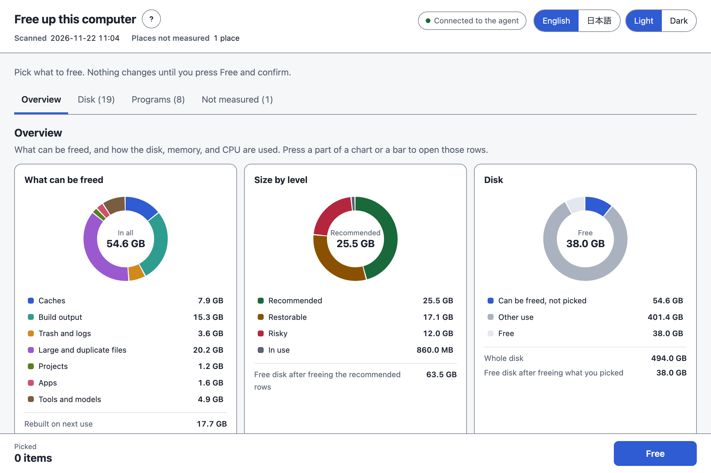
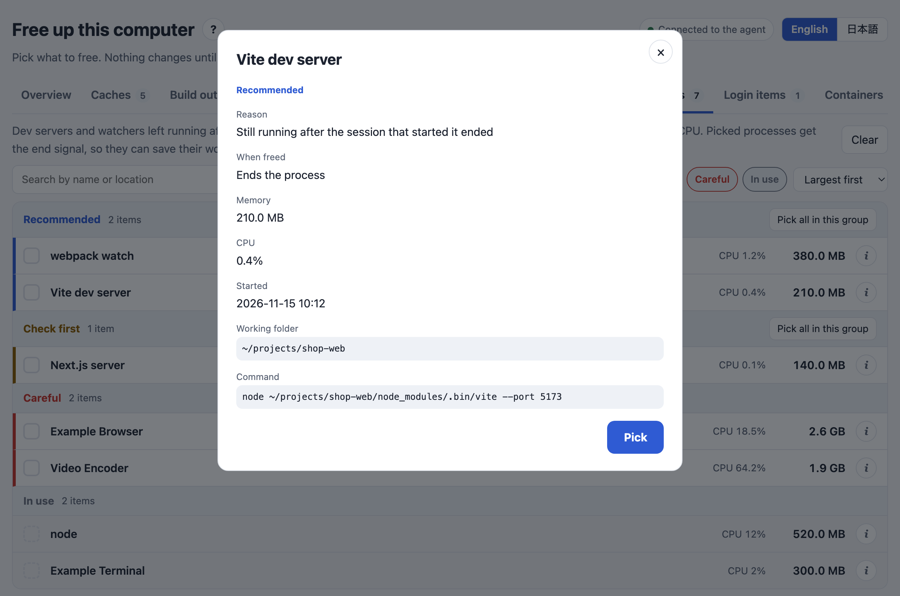

# Machine Cleanup

Get disk space, memory, and CPU back on your computer by freeing only what you pick.

English · [日本語](README.ja.md)



Coding agents leave a lot behind: `node_modules` and build output in every project, package manager and Docker caches, Xcode's DerivedData, projects nobody has opened for a month, old versions of Node.js, Python, Ruby, and Rust, downloaded AI models, and dev servers and watchers that keep running after the session that started them ended.
This plugin measures all of it at the lowest priority, shows it on a page in your browser with the size or load of each item and what freeing it does, and frees only what you pick there.
Anything that a live agent session, an open terminal, or a running program in the same project uses is shown but cannot be picked, so a cleanup never breaks work in progress in another session.

```
Scan ──> Pick on the page ──> Check each pick again ──> Free it ──> Report before and after
 (agent)  (you)                (agent)                   (agent)     (agent)
```

## Install

```
/plugin marketplace add cardene777/agent-shuriken        # Claude Code
/plugin install machine-cleanup@agent-shuriken

codex plugin marketplace add cardene777/agent-shuriken   # Codex
codex plugin add machine-cleanup@agent-shuriken

copilot plugin marketplace add cardene777/agent-shuriken # GitHub Copilot CLI
copilot plugin install machine-cleanup@agent-shuriken

gemini skills install https://github.com/cardene777/agent-shuriken.git --path plugins/machine-cleanup/skills/machine-cleanup   # Gemini CLI
```

In other agents that read `SKILL.md`, unzip the skill zip attached to each release into the agent's skills folder, as [Getting started](../../docs/getting-started.md#install-without-the-marketplace) shows.

## Use

The plugin starts when you say something like "my disk is full", "my Mac is slow", or "what is using all my memory?".
You can also call it: run `/machine-cleanup:machine-cleanup` in Claude Code, or type `$` and pick **Machine Cleanup** in Codex.
In GitHub Copilot CLI, write `/machine-cleanup` in your request, and in Gemini CLI, describe the task.

1. The agent scans, which takes up to 90 seconds at the lowest priority, and tells you the totals
2. A page opens in your browser on the **Overview** tab, whose charts show what can be freed and how the disk, memory, and CPU are used. The **Disk** and **Programs** tabs list the rows in one table per level, **Recommended**, **Restorable**, **Risky**, and **In use**, with the level of each row as a tag. Press a row's name to see its reason, location, and command beside the list. On a narrow screen the details take the place of the list, with **Back to the list** and links to the previous and next rows, and the address keeps the shown row as `#item-<id>`
3. Search by name or location, filter by kind and level, sort by the column headers, and page through 50 rows at a time. Pick the rows you want to free with the button at the end of each row, or press **Pick all** on the recommended or restorable level. Press **Free**, check the window that lists each picked row under what freeing it does, and press **Free** there
4. The agent checks each pick again, skips any that changed or came into use, frees the rest, and reports free disk, memory, and load before and after
5. When a process ignores the end signal, the agent asks you before ending it at once



The page opens in English and has an English / 日本語 switch in its header.
Next to it, a Light and Dark switch changes the colors. The colors follow your system setting until you choose, and your browser keeps the choice in its local storage under `machine-cleanup-theme`.
When the agent stopped waiting for the page, a notice above the tabs says so. Press **Free**, then **Copy** in the window that opens, and paste the selection into the chat.

## Run it on a schedule

Ask the agent to clean up on its own, and it asks which kinds to approve, with each kind's size from the last scan, and whether to run daily or weekly.
Only three kinds can be approved: `cache` (caches tools rebuild), `build` (build output git ignores, in a project with no commit for 30 days), and `log` (logs older than 30 days).
`schedule add` registers one job at 03:00, on Sunday when weekly, as a LaunchAgent on macOS, a systemd user timer on Linux, or one crontab line where no systemd user session runs.
Each run frees only the approved kinds' rows that the scan ranks Recommended, after the same check `apply` runs, and records what it freed.
`schedule show` and the next scan print the last run, and `schedule remove` takes the job away.
A schedule never frees administrator rows.
[How it works](docs/how-it-works.md#the-schedule) lists what each kind frees and leaves.

## Rows that need administrator rights

Some places only an administrator can change: on macOS, caches in `/Library/Caches`, old logs in `/Library/Logs` and `/private/var/log`, apps an administrator installed in `/Applications`, and the plists in `/Library/LaunchDaemons` and `/Library/LaunchAgents`; on Linux, the apt and dnf caches, journald's logs, and services whose unit file sits in `/etc/systemd/system`.
The scan measures them without a password, shows what it cannot read as **Not measured**, and tags their rows **Administrator** on the page.
When you pick some of them and press **Free**, the agent frees your other picks first and then runs one `sudo -A` command. The operating system's password dialog asks for your password once, for all of them, and `askpass.sh` hands what you type only to `sudo`, so the agent never sees it.
Where `sudo` needs no password, the agent runs `sudo -n` instead and no dialog opens.
Where no dialog can open, over SSH or on Linux without a display or a dialog program, and `sudo` asks for a password, these rows show their size and level but cannot be picked, and their details say why.
Places System Integrity Protection guards and Apple's own caches never appear.

## What it finds

| Kind | What it lists | What freeing it does |
|---|---|---|
| Caches | Caches of npm, pnpm, Yarn, Bun, pip, uv, Homebrew, Cargo, Go, Gradle, Maven, and CocoaPods, Docker images and build cache, Xcode DerivedData and device support, and app caches of 50 MB or more | The tool downloads or builds it again the next time it needs it. Where the tool has its own clean command, such as `npm cache clean --force`, `brew cleanup --prune=all`, or `docker builder prune`, that command runs |
| Build output | `node_modules`, `.next`, `dist`, `target`, `.venv`, and similar folders in git projects that git ignores and that hold no tracked file | Deleted. The next install or build makes it again |
| Trash and logs | The Trash, logs and crash reports older than 30 days, and installers in Downloads older than 30 days | The Trash is emptied and old logs are deleted for good. Installers move to the Trash |
| Large and duplicate files | Files of 500 MB or more, and files of 10 MB or more with the same content in several places | Moved to the Trash. At least one copy of each duplicate always stays |
| Projects | git projects with no commit or checkout for 30 days, nothing uncommitted, and every commit on the remote as of the last fetch | Moved to the Trash, so you can put them back |
| Apps | macOS apps not opened for 90 days that you can change without an administrator password, with their support files, files left behind by removed apps in your Library on macOS, and Flatpak apps installed for you on Linux | macOS apps move to the Trash with their support files, and leftovers move to the Trash. Flatpak apps are uninstalled |
| Tools and models | Versions kept by nvm, fnm, pyenv, rbenv, asdf, mise, and rustup that are neither the default nor named by a project, and models downloaded by Ollama, Hugging Face, and LM Studio | Deleted. Tool versions are removed with `rustup toolchain uninstall` for Rust, and Ollama models with `ollama rm` while Ollama runs. The tool can download them again |
| Processes | Dev servers, watchers, and test runs left running after their session ended, and the 15 processes that use the most memory or CPU | The process gets the end signal, so it can save its work. It is ended at once only when you pick it again |
| Login items | macOS LaunchAgents in your Library, and autostart entries and systemd user services on Linux | Stopped, and kept so that the agent can turn it back on |
| Containers | Running Docker containers | Stopped. Their data stays |
| System (administrator) | On macOS, caches in `/Library/Caches` of 50 MB or more, or that it cannot read, other than Apple's, files older than 30 days in `/Library/Logs` and `/private/var/log`, apps in `/Applications` an administrator installed that nobody opened for 90 days, and the plists in `/Library/LaunchDaemons` and `/Library/LaunchAgents`. On Linux, the apt and dnf caches, journald's logs, and enabled services whose unit file sits in `/etc/systemd/system` | System caches and old system logs are deleted. The apt and dnf caches are freed with `apt-get clean` and `dnf clean all`, and journald with `journalctl --vacuum-time=30d`. Apps move to your Trash. Launch daemons and agents are stopped and kept in `/Library/Application Support/machine-cleanup/disabled/`, and services are turned off with `systemctl disable --now`, so the agent can put them back |

A file or folder appears in one row only: an old installer in Downloads is listed under Trash and logs, not again as a large file.
A row inside another row, such as `node_modules` in an unused project or an app's cache, keeps its own row so that you can free it alone. The totals count it once, and when you pick both, the agent frees the outer row with the inner one in it.

## What it keeps out of reach

- Anything a live agent session (Claude Code, Codex, GitHub Copilot CLI, or Gemini CLI) or an open terminal runs, the app or terminal a session runs in, processes working in a project a session works in, and every item in a project where a running program works. These rows show why and cannot be picked
- Sync folders such as iCloud Drive, Dropbox, Google Drive, and OneDrive, because deleting there deletes in the cloud too, and Windows drives under WSL
- Symbolic links and what they point to, files git tracks, and Docker volumes
- Places System Integrity Protection guards, Apple's caches in `/Library/Caches`, and other users' processes
- Operating system settings such as swap and indexing

## Requirements

| Tool | When it's needed |
|---|---|
| `python3` | Always, on macOS, Linux, or WSL |
| `ps`, `du`, `df` | Always. Built into macOS and Linux |
| `lsof` | On macOS, to tell which projects running programs work in. Built into macOS. Linux reads `/proc` instead |
| `git` | To tell build output from tracked files |
| `docker` | Optional. When it is installed and running, its caches and running containers are listed |
| npm, pnpm, Yarn, Bun, pip, uv, Homebrew, Go, CocoaPods | Optional. When one is installed, its own clean command frees its cache. Without it, the cache folder is deleted |
| `flatpak` | Optional, on Linux, to list Flatpak apps |
| `launchctl`, `systemctl`, or `crontab` | Only for a schedule: `launchctl` on macOS, and a systemd user session or `crontab` on Linux and WSL |
| `sudo` | Only to free administrator rows. On Linux, the password dialog needs a display and `zenity`, `kdialog`, or `ssh-askpass`. macOS opens its own dialog with `osascript` |
| A web browser | To pick on the page |
| The design-formats plugin | Optional. When its page-design skill is installed, the agent checks the page's template with its verify |
| The `musubi` command | Optional. When it is installed, the agent runs `musubi check` before reading the page-design formats |

## What it reads, runs, and sends

[How it works](docs/how-it-works.md) explains the scan, what counts as in use, the page and its server, and the check before each change.
In short:

- It reads the sizes and dates of files and folders in your home folder and app folders, reads the contents of files of 10 MB or more that have the same size as another file to tell duplicates apart, and lists your processes, login items, and containers
- It reads the version files in your projects (`.nvmrc`, `.python-version`, `.tool-versions`, `mise.toml`, `rust-toolchain.toml`, and similar), the version managers' settings, and Ollama's model manifests
- It runs `ps`, `du`, `df`, `lsof`, `git`, `mdls` on macOS, and, when they are installed, `docker`, `flatpak`, `rustup`, `ollama`, and the package managers' clean commands. `git` only reads, and never fetches
- It serves the page only on `127.0.0.1` with a one-time token and accepts a selection only from that page. It sends nothing over the network
- It changes only what you picked, after checking it again, and a schedule frees only the kinds you approved. It uses administrator rights only through the one `sudo -A` command for the administrator rows you picked, and the password goes from the operating system's dialog to `sudo` without reaching the agent or a file
- It measures system places without a password. `MACHINE_CLEANUP_SYSTEM_ROOT` points them at another folder, which the tests use; run as root, `admin-apply` and `admin-restore` refuse any folder other than `/`
- It hides values of command-line flags and environment variables whose names suggest a token, secret, password, or API key before a process command reaches the page or a file
- It keeps the scan, the page session, what `restore` needs, and a schedule with its copy of the script and the record of its runs in `~/.local/share/machine-cleanup/`, readable only by you. `finish` removes everything but the restore records and the schedule
- `skills/machine-cleanup/musubi.json` declares through musubi that machine-cleanup follows the `structure` and `look` formats, the `sheet` page type, and `verify` of page-design, in the design-formats plugin, as optional follows with `"optional": true`. The agent reads them only when page-design is installed, runs page-design's verify on the page's template, and otherwise uses the skill's own template. It reads nothing else from other plugins

## License

[MIT](LICENSE)
