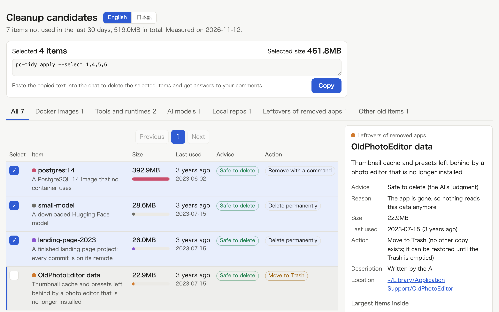

# PC Tidy

Macで使われなくなった物を確かめ、選んだ物だけを消してディスクの空きを取り戻します。

[English](README.md) · 日本語



このプラグインは、ホームフォルダから作業フォルダ、手元のリポジトリ、アプリ、消したアプリの残り、古いバージョンのツール、AIのモデル、Dockerのimage、増え続けるログを探します。
30日使われていない物を一覧にし、それぞれが何で、消してよいかを示し、あなたが選んだ物だけを消します。
作り直せるキャッシュは消さず、写真、鍵、iCloud Drive、メールには一切触れません。

```
一覧を作る                            エージェント
  ↓
各項目を説明し、消してよいかを示す    エージェント
  ↓
ページで選ぶ                          あなた
  ↓
選んだ物だけを消す                    エージェント
  ↓
空いた容量を報告する                  エージェント
```

## インストール

```
/plugin marketplace add cardene777/agent-shuriken        # Claude Code
/plugin install pc-tidy@agent-shuriken

codex plugin marketplace add cardene777/agent-shuriken   # Codex
codex plugin add pc-tidy@agent-shuriken

copilot plugin marketplace add cardene777/agent-shuriken # GitHub Copilot CLI
copilot plugin install pc-tidy@agent-shuriken

gemini skills install https://github.com/cardene777/agent-shuriken.git --path plugins/pc-tidy/skills/pc-tidy   # Gemini CLI
```

`SKILL.md`を読むほかのエージェントでは、各リリースに添付したスキルのzipを、そのエージェントのスキル用フォルダに展開します。
手順は[はじめに](../../docs/getting-started.ja.md#マーケットプレイスを使わずにインストールする)にあります。

## 使い方

このプラグインは、あなたが呼び出した時だけ動きます。
Claude Codeでは`/pc-tidy:pc-tidy`を実行し、Codexでは`$`を入力して**PC Tidy**を選びます。
GitHub Copilot CLIでは依頼の中に`/pc-tidy`と書き、Gemini CLIでは名前を挙げて頼みます。
これらのエージェントでは、やりたいことを伝えただけで始まることもありますが、その場合も項目を選ぶまで何も消しません。

1. エージェントがホームフォルダを調べ、30日を超えて触れていない物を一覧にします。数分かかります
2. エージェントが選ぶページを開きます。このページには、それぞれが何かと、「消してよい」「確かめてから」「残す」のどれに当たるかが出ます
3. 消す物を選び、迷う物にはコメントを書いて、コピーした文をチャットに貼ります
4. エージェントがコメントに答え、選んだ物だけを消します。消す直前には、未コミットの変更と動いているプロセスが無いかをもう一度確かめます
5. エージェントが、消した物、飛ばした物とその理由、空き容量がどれだけ変わったかを報告します

コマンドはホームフォルダ全体を読み、プロジェクトのフォルダの外で削除するので、Codexのようにエージェントのサンドボックスに聞かれた時は承認してください。

## 必要な物

| ツール | 必要な時 |
|---|---|
| macOS | 常に |
| `python3` | 常に。macOSに最初から入っている物で動きます |
| `git` | 作業フォルダとリポジトリを測る時 |
| `docker` | Dockerのimageを測る時。無い時は、その種類を「測れなかった」と報告します |

## 読む物と実行する物と送る物

項目の種類、それぞれの消し方、常に守られる物は、すべて[仕組み](docs/how-it-works.ja.md)に載せています。
要点は次のとおりです。

- ホームフォルダの下にあるファイルの大きさと日付を読み、`git`、`mdls`、`docker`に使用状況を問い合わせます
- ネットワークには一切接続しません
- 選んだ物だけを、1つずつ確かめ直してから消します。消したアプリの残りと、どの種類にも当たらない物はゴミ箱へ移します
- 設定とログは`~/.local/share/pc-tidy/`に置き、`PC_TIDY_HOME`を設定した時はそちらに置きます

## ライセンス

[MIT](LICENSE)
