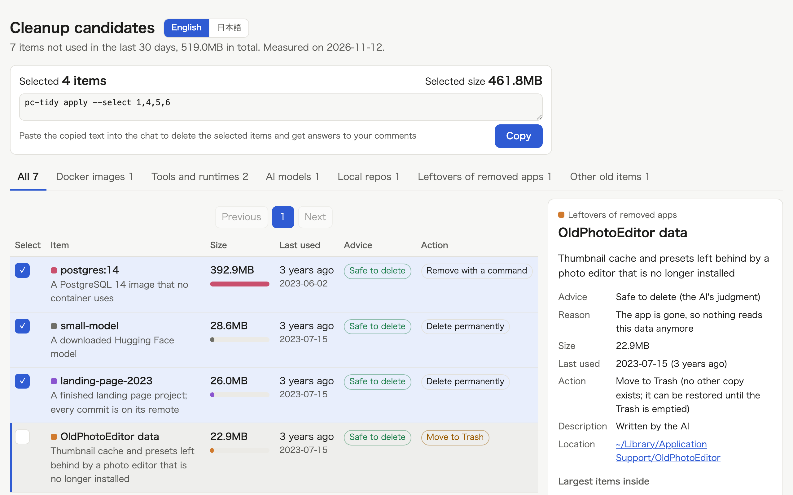

# PC Tidy

See what has gone unused on your Mac, and get the disk space back by deleting only the items you pick.

English · [日本語](README.ja.md)



The plugin scans your home folder for work folders, local repositories, apps, leftovers of removed apps, old tool versions, AI models, Docker images, and logs that keep growing.
It lists what has gone unused for 30 days, says what each item is and whether it is safe to delete, and deletes only what you pick.
It never deletes caches that can be rebuilt, and it never touches photos, keys, iCloud Drive, or mail.

```
Build the list ──> Describe each item and recommend ──> Pick on the page ──> Delete only the picks ──> Report the space freed
 (agent)            (agent)                              (you)                (agent)                   (agent)
```

## Install

```
/plugin marketplace add cardene777/agent-shuriken        # Claude Code
/plugin install pc-tidy@agent-shuriken

codex plugin marketplace add cardene777/agent-shuriken   # Codex
codex plugin add pc-tidy@agent-shuriken
```

## Use

The plugin runs only when you call it.
Run `/pc-tidy:pc-tidy` in Claude Code, or type `$` and pick **PC Tidy** in Codex.

1. The agent scans your home folder and lists items untouched for more than 30 days. This takes a few minutes
2. The agent opens a pick page that says what each item is and whether it is safe to delete, should be checked first, or should be kept
3. Pick the items to delete, leave comments on anything you're unsure about, and paste the copied text into the chat
4. The agent answers your comments and deletes only what you picked. Right before deleting, it re-checks for uncommitted changes and running processes
5. The agent reports what it deleted, what it skipped and why, and how much free space changed

In Codex, approve the commands when the sandbox asks, because they read your whole home folder and delete outside the project folder.

## Requirements

| Tool | When it's needed |
|---|---|
| macOS | Always |
| `python3` | Always. The one that ships with macOS works |
| `git` | When measuring work folders and repositories |
| `docker` | When measuring Docker images. Without it, that category is reported as unmeasured |

## What it reads, runs, and sends

[How it works](docs/how-it-works.md) lists every kind of item, how each is removed, and what is always protected.
In short:

- It reads file sizes and dates under your home folder, and asks `git`, `mdls`, and `docker` for usage information
- It connects to nothing on the network
- It deletes only the items you pick, after re-checking each one, and moves leftovers of removed apps and uncategorized items to the Trash
- Its settings and logs live in `~/.local/share/pc-tidy/`, or in `PC_TIDY_HOME` when it is set

## License

[MIT](LICENSE)
