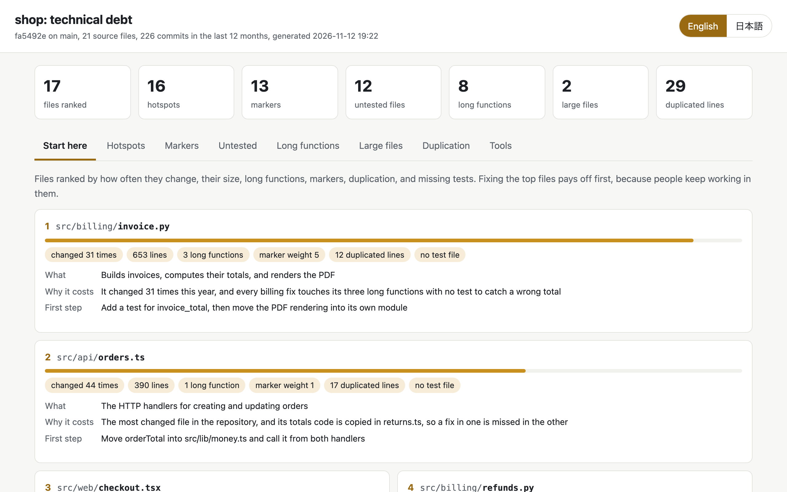

# Tech Debt

先に直す価値のある技術的負債を見つけます。チームが何度も手を入れていて、しかも大きい、テストが無い、長い関数や古いTODOや写したコードが多いファイルです。

[English](README.md) · 日本語



リンターは何千もの警告を並べますが、どれが大事かは教えてくれません。
負債が効いてくるのは人が作業し続ける所です。誰も触らない2,000行のファイルの負担は小さく、毎週変わる400行のファイルの負担は大きくなります。
このプラグインはコードとgitの履歴を読み、ファイルごとの変更の回数に、大きさ、長い関数、TODOとFIXMEのコメントとその古さ、重複した部分、テストの有無を合わせて、直すほど効き目の大きいファイルから順位を付けます。
そのうえでエージェントが上位のファイルを読み、何のファイルか、なぜチームの負担になるか、直す最初の一手を書きます。

```
コードと履歴を測る ──> ファイルに順位を付ける ──> 上位のファイルを説明する ──> 報告を見せる
 (エージェント)        (エージェント)             (エージェント)               (エージェント)
```

## インストール

```
/plugin marketplace add cardene777/agent-shuriken        # Claude Code
/plugin install techdebt@agent-shuriken

codex plugin marketplace add cardene777/agent-shuriken   # Codex
codex plugin add techdebt@agent-shuriken

copilot plugin marketplace add cardene777/agent-shuriken # GitHub Copilot CLI
copilot plugin install techdebt@agent-shuriken

gemini skills install https://github.com/cardene777/agent-shuriken.git --path plugins/techdebt/skills/techdebt   # Gemini CLI
```

`SKILL.md`を読むほかのエージェントでは、各リリースに添付したスキルのzipを、そのエージェントのスキル用フォルダに展開します。
手順は[はじめに](../../docs/getting-started.ja.md#マーケットプレイスを使わずにインストールする)にあります。

## 使い方

このプラグインは、「このリポジトリの技術的負債はどこにあって、何から直すべき？」のように技術的負債について尋ねると始まります。
呼び出して始めることもできます。Claude Codeでは`/techdebt:techdebt`の後に必要ならフォルダを続けて実行し、Codexでは`$`を入力して**Tech Debt**を選びます。
GitHub Copilot CLIでは依頼の中に`/techdebt`と書き、Gemini CLIではやりたいことを伝えます。

1. エージェントがリポジトリか、その中のフォルダ(monorepoのパッケージ1つなど)を調べます
2. エージェントがファイルに順位を付け、上位のファイルを読んで、何のファイルか、なぜ負担になるか、直す最初の一手を書きます
3. エージェントが報告のページを開き、上位のファイルと各項目の合計をチャットでまとめます

画像のリポジトリを調べた結果の要約は、次のように始まります。

```text
techdebt scan of ~/work/shop (HEAD 61d7f14 on main, 26 source files, 5 test files, 199 commits in the last 12 months)
Hotspots:       19 files changed 2 or more times
Markers:        6 (FIXME 1, HACK 1, TODO 4), oldest 360 days
Untested:       15 source files have no test file with a matching name
Long functions: 7 over 60 lines
Large files:    1 over 500 lines
Duplication:    2 blocks, 20 lines
Unused deps:    2 (approximate: names not found in imports, configs, or scripts)
Deprecated calls: 3 (eslint 3; not run: ruff, semgrep)
Tool ruff:      not run, ruff is not installed in .venv/bin or on PATH

Start here
 1  src/billing/invoice.py  score 0.97  changed 31 times, 543 lines, 3 long functions, marker weight 4, 11 duplicated lines, no test file
 2  src/api/orders.ts  score 0.67  changed 44 times, 331 lines, 1 long function, marker weight 1, 9 duplicated lines, no test file
 3  src/web/checkout.tsx  score 0.40  changed 25 times, 220 lines, 2 long functions, marker weight 2, no test file
 4  src/billing/refunds.py  score 0.36  changed 18 times, 163 lines, 1 long function, marker weight 1, 11 duplicated lines, no test file
 5  src/api/returns.ts  score 0.17  changed 13 times, 70 lines, 9 duplicated lines, no test file
```

順位は20位まで続き、最後の2行にデータと報告のページの置き場が出ます。

報告のページには、順位のタブと項目ごとのタブがあり、英語と日本語を切り替えられます。
使っていない依存は、knipが無い時も、import、設定のファイル、`scripts`で名前を探して見つけるので、その数は概算です。knipが入っている時は、knipの結果を使います。
非推奨の呼び出しは、すでに入っている道具で探します。ruffは非推奨の規則で、semgrepはプロジェクトの規則のfileだけを`--metrics off`で、ESLintは設定が非推奨の規則を有効にしている時だけ回します。semgrepのセキュリティの規則の結果は出しません。

## 必要な物

| 道具 | 要る時 |
|---|---|
| `python3` | 常に |
| `git` | ファイルごとの変更の回数、TODOのコメントの古さ、順位付けに使います。無くてもほかの項目は測れます |
| `knip` | 任意です。プロジェクトの`node_modules/.bin`に入っている時に使います |
| `ruff` | 任意です。`.venv/bin`か`PATH`に入っている時に使います |
| `semgrep` | 任意です。`.venv/bin`か`PATH`に入っていて、プロジェクトが規則のfile(`.semgrep.yml`、`.semgrep.yaml`、`.semgrep/`)を持つ時に使います |
| `eslint` | 任意です。プロジェクトの`node_modules/.bin`に入っていて、設定が非推奨の規則を有効にしている時に使います |

## 読む物、動かす物、送る物

[仕組み](docs/how-it-works.ja.md)に、各項目の測り方、順位の付け方、飛ばす物を載せています。
要点は次のとおりです。

- 調べるフォルダのソースファイルと、gitの履歴(`git log`、`git blame`)を読みます
- `knip`、`ruff`、`semgrep`、`eslint`は、すでに入っている時だけ動かします。何も取り寄せず、何も入れません
- semgrepは`--metrics off`と`--disable-version-check`を付け、プロジェクトの規則のfileだけで回します。登録所の規則は読みません。semgrepの設定と記録は一時のフォルダーに書かせ、回した後に消します
- プロジェクトのファイルは一切書き換えません
- ネットワークにはつなぎません
- `scan.json`、エージェントの説明、`report.html`を`~/.local/share/techdebt/<project>/`に置き、あなただけが読めるようにします。消すまで残ります
- 目印のある行は200文字まで残します。鍵、トークン、パスワードに見える文字列は`***`に、ホームフォルダは`~`に置き換えます

## ライセンス

[MIT](LICENSE)
