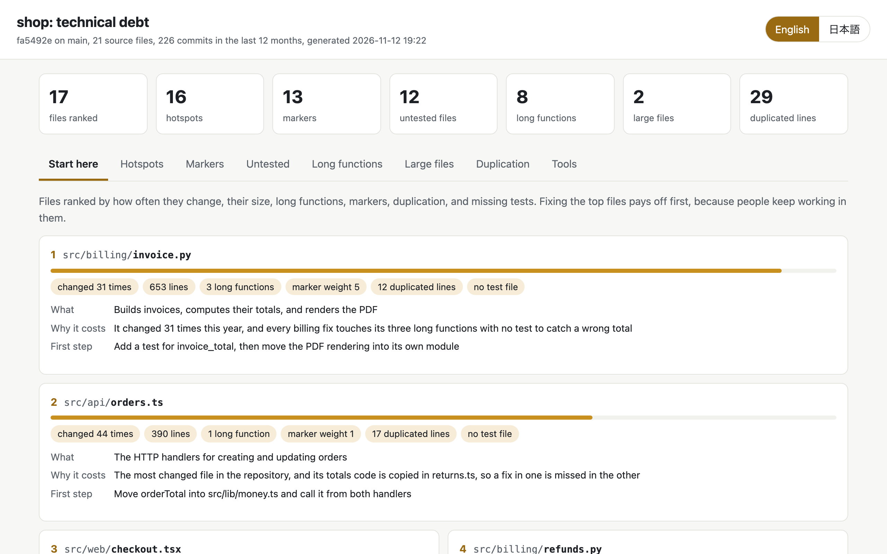

# Tech Debt

Find the technical debt worth fixing first: the files your team keeps changing that are also large, untested, or full of long functions, old TODOs, and copied code.

English · [日本語](README.ja.md)



Linters list thousands of warnings without saying which ones matter.
Debt matters where people keep working: a 2,000-line file nobody touches costs little, and a 400-line file changed every week costs a lot.
This plugin reads your code and its git history, combines how often each file changes with its size, long functions, TODO and FIXME comments and their age, duplicated blocks, and missing tests, and ranks the files where fixing pays off first.
The agent then reads the top files and writes what each one is, why it costs the team, and the first step to fix it.

```
Measure the code and its history ──> Rank the files ──> Explain the top files ──> Show the report
 (agent)                              (agent)            (agent)                   (agent)
```

## Install

```
/plugin marketplace add cardene777/agent-shuriken        # Claude Code
/plugin install techdebt@agent-shuriken

codex plugin marketplace add cardene777/agent-shuriken   # Codex
codex plugin add techdebt@agent-shuriken

copilot plugin marketplace add cardene777/agent-shuriken # GitHub Copilot CLI
copilot plugin install techdebt@agent-shuriken

gemini skills install https://github.com/cardene777/agent-shuriken.git --path plugins/techdebt/skills/techdebt   # Gemini CLI
```

In other agents that read `SKILL.md`, unzip the skill zip attached to each release into the agent's skills folder, as [Getting started](../../docs/getting-started.md#install-without-the-marketplace) shows.

## Use

The plugin starts when you ask about technical debt, for example "where is the tech debt in this repo, and what should we refactor first?".
You can also call it: run `/techdebt:techdebt` in Claude Code, optionally followed by a folder, or type `$` and pick **Tech Debt** in Codex.
In GitHub Copilot CLI, write `/techdebt` in your request, and in Gemini CLI, describe the task.

1. The agent scans the repository, or a folder inside it such as one package of a monorepo
2. The agent ranks the files and reads the top ones to write what each is, why it costs the team, and the first step to fix it
3. The agent opens the report and sums up the top files and the totals in the chat

The scan prints a summary like this.

```text
techdebt scan of ~/work/shop (HEAD 3f2a91c on main, 412 source files, 96 test files, 388 commits in the last 12 months)
Hotspots:       118 files changed 2 or more times
Markers:        57 (FIXME 9, HACK 3, TODO 41, deprecated 4), oldest 1312 days
Untested:       64 source files have no test file with a matching name
Long functions: 22 over 60 lines
Large files:    7 over 500 lines
Duplication:    11 blocks, 214 lines
Tool knip:      38 findings

Start here
 1  src/billing/invoice.py  score 0.86  changed 31 times, 612 lines, 3 long functions, marker weight 5, no test file
 2  src/api/orders.ts  score 0.71  changed 44 times, 380 lines, 1 long function, 26 duplicated lines
```

The report has a tab for the ranking and one per measure, and switches between English and Japanese.

## Requirements

| Tool | When it's needed |
|---|---|
| `python3` | Always |
| `git` | For changes per file, the age of TODO comments, and the ranking. Without it the other measures still run |
| `knip` | Optional. Used when installed in the project's `node_modules/.bin` |
| `ruff` | Optional. Used when installed in `.venv/bin` or on `PATH` |

## What it reads, runs, and sends

[How it works](docs/how-it-works.md) explains each measure, the ranking, and what is skipped.
In short:

- It reads the source files of the folder you scan and its git history (`git log`, `git blame`)
- It runs `knip` and `ruff` only when they are already installed, and never downloads or installs anything
- It never changes a file in your project
- It connects to nothing on the network
- It keeps `scan.json`, the agent's notes, and `report.html` in `~/.local/share/techdebt/<project>/`, readable only by you, until you delete them

## License

[MIT](LICENSE)
